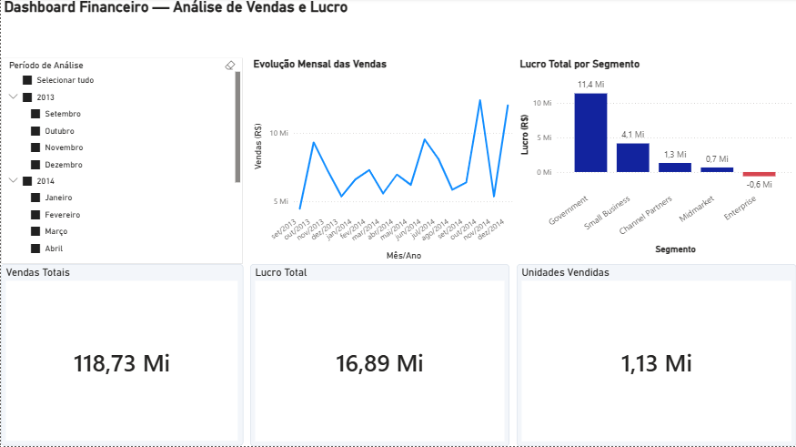
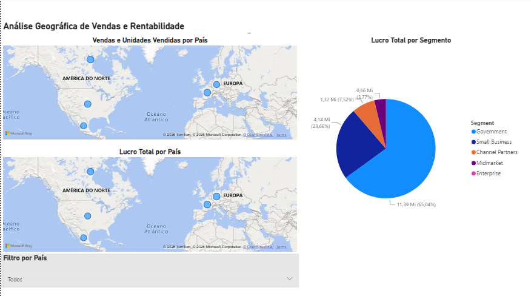
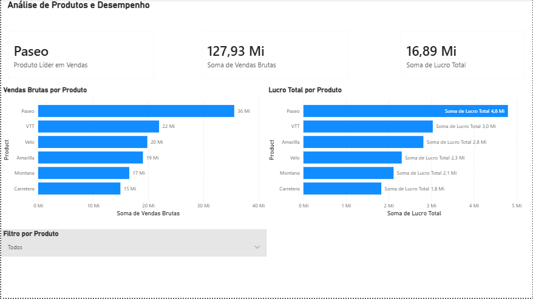

# 📊 Desafio Power BI — Bootcamp DIO

## Dashboard Financeiro: Vendas, Rentabilidade e Desempenho

Projeto desenvolvido como parte do desafio prático de **Power BI da DIO**, com o objetivo de aplicar os conhecimentos adquiridos durante o Bootcamp na construção e análise de relatórios interativos.

O desafio propôs a reprodução de páginas desenvolvidas durante o curso e a criação de uma nova página utilizando diferentes recursos de visualização de dados.

Além dos requisitos propostos, o projeto foi ampliado com uma análise específica de desempenho de produtos, filtros interativos e indicadores adicionais, buscando transformar o exercício em um projeto de portfólio.

**Autor:** Marcos Roberto

---

## 🎯 Objetivo do Projeto

Este projeto tem como objetivo desenvolver habilidades práticas na criação de relatórios interativos no **Microsoft Power BI**, utilizando dados financeiros para transformar informações em visualizações claras e úteis para análise.

O desafio permitiu trabalhar diferentes perspectivas dos dados, incluindo:

- evolução das vendas ao longo do tempo;
- análise de vendas, lucro e unidades vendidas;
- desempenho por segmento;
- análise geográfica por país;
- comparação de vendas e rentabilidade por produto;
- utilização de filtros e segmentações para exploração interativa dos dados.

A proposta original da DIO foi utilizada como base e complementada com melhorias na organização dos visuais, indicadores adicionais e uma página específica para análise de produtos.

---

## 🧠 Aprendizados e Competências Desenvolvidas

Durante o desenvolvimento deste desafio, foram praticados conceitos fundamentais para a construção e organização de relatórios no Power BI.

Entre os principais aprendizados estão:

- criação e organização de páginas de relatório;
- construção de cartões para acompanhamento de indicadores;
- utilização de gráficos de linha, barras, pizza e mapas;
- criação de segmentações de dados e filtros interativos;
- análise de vendas, lucro e unidades vendidas;
- análise de desempenho por segmento, país e produto;
- configuração das interações entre filtros e visualizações;
- utilização de campos em dicas de ferramentas (tooltips);
- ordenação cronológica de informações de mês e ano;
- criação e utilização de colunas calculadas;
- aplicação de DAX na criação de indicador para identificação do produto líder em vendas;
- organização, alinhamento e padronização dos elementos visuais;
- validação do comportamento dos filtros e indicadores;
- identificação e correção de elementos redundantes no relatório;
- revisão funcional e visual antes da entrega final.

Além da construção dos visuais, o desenvolvimento do projeto reforçou uma sequência de trabalho importante para projetos de Business Intelligence:

**Construir → Testar → Identificar inconsistências → Corrigir → Validar → Documentar → Versionar.**

---

## 📊 Páginas do Relatório

### 1. Dashboard Financeiro — Análise de Vendas e Lucro

A primeira página apresenta uma visão executiva dos principais indicadores financeiros do conjunto de dados.

Foram utilizados:

- **Vendas Totais:** R$ 118,73 milhões;
- **Lucro Total:** R$ 16,89 milhões;
- **Unidades Vendidas:** 1,13 milhão;
- evolução mensal das vendas;
- lucro total por segmento;
- segmentação por ano e mês para análise do período.

A organização dessa página permite acompanhar os principais indicadores e, ao mesmo tempo, analisar a evolução temporal e a contribuição dos diferentes segmentos.



### 2. Análise Geográfica de Vendas e Rentabilidade

A segunda página apresenta uma análise geográfica dos resultados, permitindo observar a distribuição do desempenho financeiro entre os países presentes na base de dados.

Foram utilizados:

- mapa de **Vendas e Unidades Vendidas por País**;
- mapa de **Lucro Total por País**;
- gráfico de pizza com o **Lucro Total por Segmento**;
- filtro interativo por país;
- utilização de campos em dicas de ferramentas para complementar a análise.

O filtro por país permite selecionar individualmente mercados como Canadá, França, Alemanha, México e Estados Unidos, atualizando os demais visuais de forma interativa.



### 3. Análise de Produtos e Desempenho

A terceira página amplia a análise do relatório com uma visão específica do desempenho dos produtos.

Foram utilizados:

- cartão para identificação do **Produto Líder em Vendas**;
- indicador de **Vendas Brutas**;
- indicador de **Lucro Total**;
- gráfico de barras de **Vendas Brutas por Produto**;
- gráfico de barras de **Lucro Total por Produto**;
- filtro interativo por produto;
- ordenação dos produtos por desempenho;
- rótulos de dados para facilitar a interpretação dos resultados.

- ---

## 🛠️ Tecnologias e Recursos Utilizados

- Microsoft Power BI Desktop
- DAX (Data Analysis Expressions)
- Modelagem e análise de dados
- Visualizações interativas
- Segmentações e filtros
- Git e GitHub para versionamento e documentação

- ---

## 📁 Estrutura do Repositório

```text
desafio-power-bi-dio/
│
├── Desafio_PowerBI_DIO_Marcos_Roberto.pbix
├── README.md
│
└── images/
    ├── dashboard-financeiro.png
    ├── analise-geografica.png
    └── analise-produtos.png

```

---

## 🚀 Conclusão

Este projeto permitiu consolidar conhecimentos fundamentais de **Business Intelligence e análise de dados com Power BI**, desde a construção dos indicadores até a organização e validação das visualizações.

Além de atender aos requisitos do desafio da DIO, o relatório foi ampliado com análises complementares de produtos, indicadores e filtros interativos, resultando em um projeto que também pode ser utilizado como parte do meu portfólio profissional.

O desenvolvimento reforçou a importância de transformar dados em informações claras, estruturadas e úteis para apoiar análises e tomadas de decisão.

---

**Desenvolvido por Marcos Roberto como parte do desafio de Power BI da DIO.**

Também foi criada uma medida em **DAX** para identificar dinamicamente o produto líder em vendas. No conjunto de dados analisado, o produto **Paseo** apresentou a liderança.

Essa página complementa as análises financeira e geográfica, permitindo comparar o desempenho comercial e a rentabilidade dos diferentes produtos.


